<div align="center">

# 🛡️ Matri-Kavach Vaani-GNANI AI HACKATHON

### A Hindi voice assistant for maternal-emergency referrals that won't let a wrong digit through.

An ASHA worker **speaks** the referral. **Vaani** finds what is missing or contradictory, **asks for it aloud**, **reads every digit back**, and sends nothing until she says **"हाँ, सब सही है"** for that exact version. It then asks the **nearest hospital that is ready tonight**, and tells the ambulance, doctor and family **only what each of them needs**.


**🎥 [Demo video](https://youtu.be/4uH6roD3MXU) · 💼 [LinkedIn post]() · 🌐 [Live preview](https://matri-kavach-gnani.onrender.com/chat)**

*Built for the **Great Indian AI Internship Challenge** by Gnani AI.*

</div>

<p align="center">
  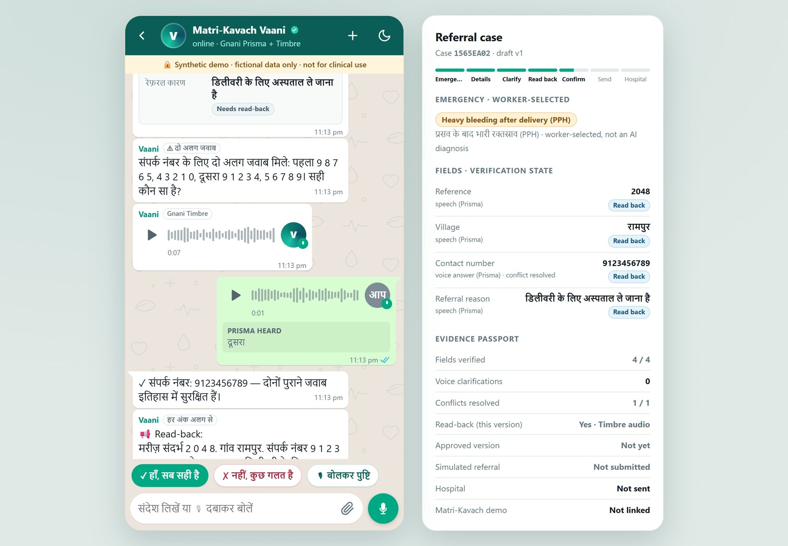
  &nbsp;
  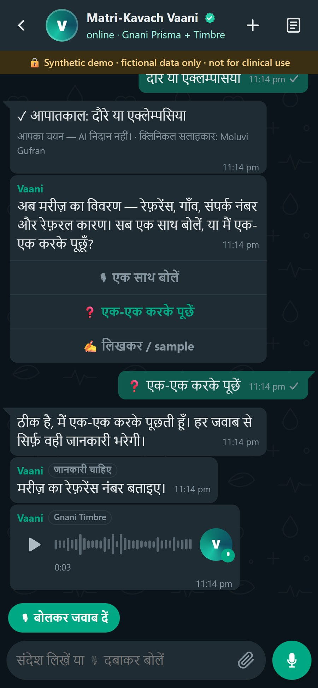
</p>
<p align="center"><sub>Two different phone numbers were heard, so Vaani picks <b>neither</b>. Timbre asks <i>"पहला या दूसरा?"</i>, the worker answers <b>"दूसरा"</b> by voice, and only that one field changes. All data shown is fictional.</sub></p>

> [!IMPORTANT]
> This is a research and hackathon prototype that uses **synthetic data only**. Vaani does not diagnose, triage or dispatch, and it must never be used with real patients.

---

## 📑 Contents

[In 30 seconds](#-in-30-seconds) · [See it work](#-see-it-work-a-referral-in-8-steps) · [Who sees what](#-who-sees-what-role-phones) · [How it works](#%EF%B8%8F-how-it-works) · [What makes it different](#-what-makes-it-different) · [Gnani models](#%EF%B8%8F-gnani-models-used) · [Evidence](#-evidence) · [Run it](#-run-it) · [Safety by design](#-safety-by-design) · [Roadmap](#%EF%B8%8F-scope-and-roadmap) · [Team](#-team)

---

## ⚡ In 30 seconds

| | |
|---|---|
| 😟 **Problem** | ASHA workers send maternal-emergency referrals under pressure. One wrong digit in a phone number, or a missing village, costs time a mother in labour does not have. |
| 👩‍⚕️ **Who** | ASHA workers, ANMs and PHC staff. Many of them prefer speaking to typing. |
| 🗣️ **What it does** | The full **Matri-Kavach** referral, voice-first. The worker chooses the emergency and speaks the details naturally. Vaani **asks** instead of guessing, **reads every digit back**, and takes a **spoken approval** of the exact version. It then routes to the **nearest ready hospital**, with an automatic backup, and gives every role **only its part** of the case. |
| 🔊 **Gnani** | **Prisma** hears the referral and every answer. **Timbre** asks the questions and reads the details back. |
| ✅ **Proof** | 221 automated tests. **0 false-ready referrals** across 24 adversarial cases and 15 bypass attempts. **0 data leaks** across 11 role phones. A live Gnani run of the full voice loop. |

## 😟 The problem

- Field researchers found that ASHAs **rarely type on their phones** and use voice dictation and WhatsApp voice notes instead ([George Institute, 2025](https://cdn.georgeinstitute.org/sites/default/files/2025-05/Large-AI-model-community-health-workers.pdf)).
- Studies of Indian maternal referrals describe **incomplete referral slips** and delays in reaching and receiving care ([Public Health, 2022](https://www.ncbi.nlm.nih.gov/pmc/articles/PMC9883712/)).
- Voice-to-text alone does not fix this. It only moves the error from the keyboard into the transcript. The missing piece is a **closed loop: ask, read back, confirm**. Aviation and hospitals use the same read-back idea for critical numbers.

---

## 🎬 See it work: a referral in 8 steps

<table>
<tr>
<td width="50%" valign="top">

### 1 · Hi → language → emergency
It opens just like Matri-Kavach. After *Hi* and a language, a list sheet offers the same emergency list. **The worker chooses the type; Vaani never diagnoses.** The checklists were reviewed by clinical advisor Moluvi Gufran.

</td>
<td width="50%">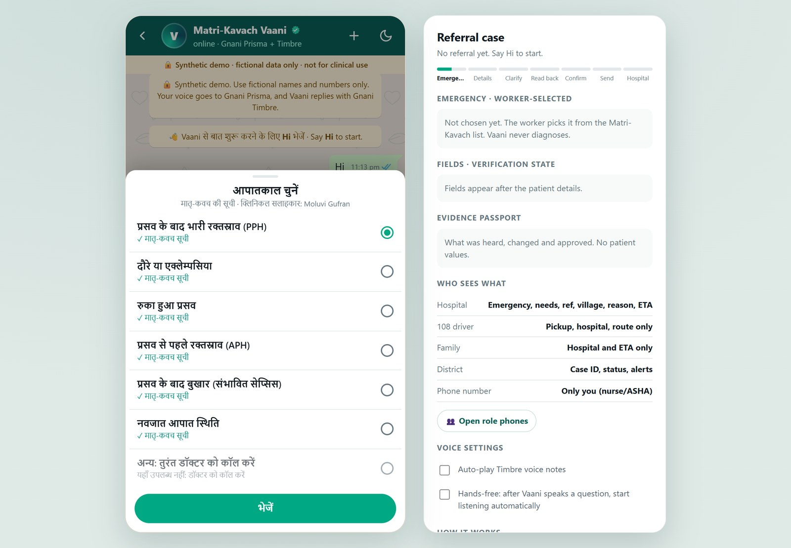</td>
</tr>
<tr>
<td valign="top">

### 2 · She speaks; Vaani spots a conflict
*"रामपुर की मरीज़ है, रेफ़रेंस 2048, नंबर 98765 43210 … माफ़ कीजिए, नंबर 91234 56789"*. Prisma transcribes it, and three of the four fields are filled from **natural speech**. Two different phone numbers were heard, so the contact is marked **⚠ Conflict**, and Timbre asks *"पहला या दूसरा?"*.

</td>
<td>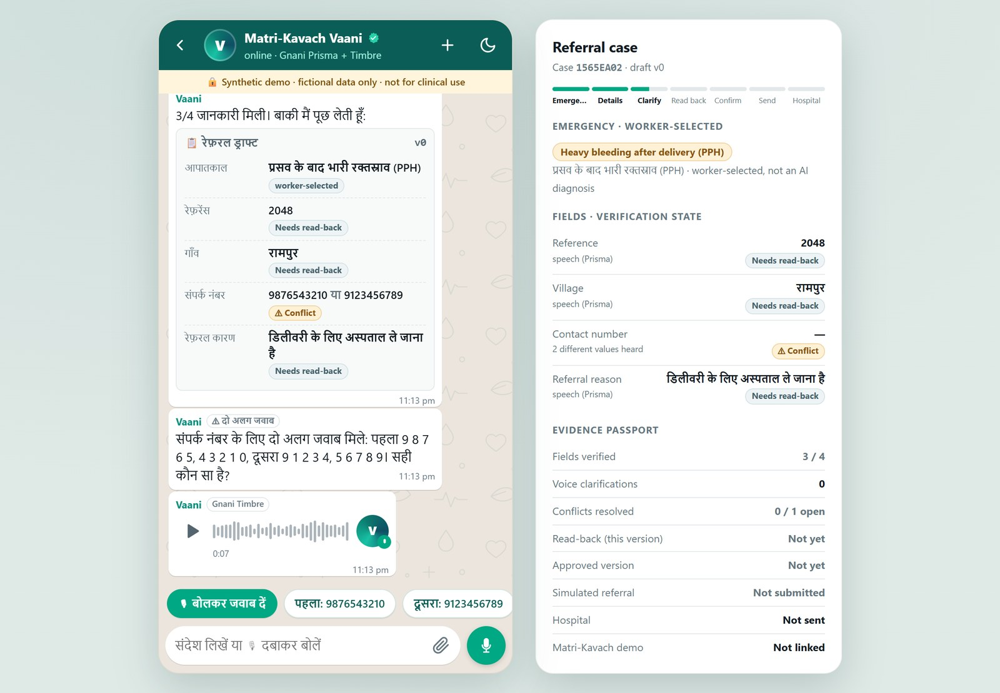</td>
</tr>
<tr>
<td valign="top">

### 3 · One spoken word resolves it
She says **"दूसरा"**. Only the contact number changes, and both original numbers stay in the history. A bare *"हाँ"*, *"ok"* or silence is **never** accepted as an answer.

</td>
<td></td>
</tr>
<tr>
<td valign="top">

### 4 · Digit-by-digit read-back, then spoken approval
Timbre reads every digit back (*"9 1 2 3 4, 5 6 7 8 9"*) and asks *"क्या सभी विवरण सही हैं?"*. She says **"हाँ, सब सही है"**. That approves **only this version**; any later change cancels it. The Evidence Passport shows *v1 · by voice 🎙*.

</td>
<td>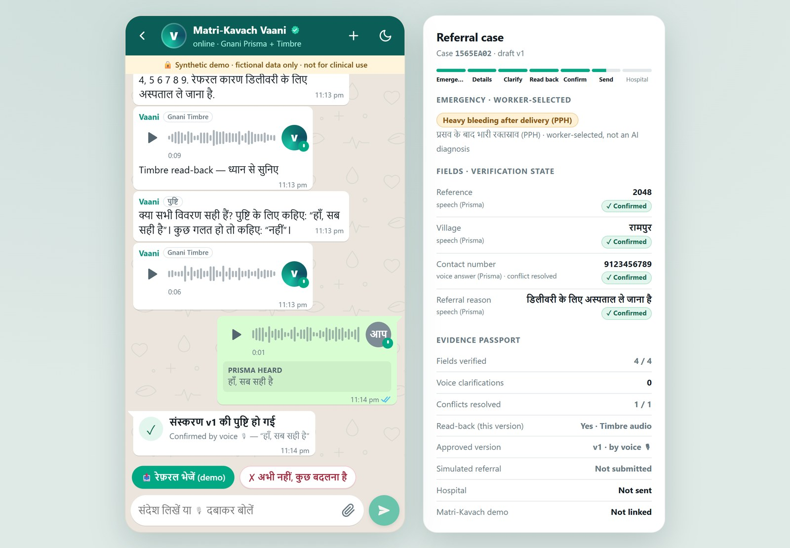</td>
</tr>
<tr>
<td valign="top">

### 5 · Which hospital is ready *tonight*?
Each hospital's readiness is checked against the emergency's checklist. **CHC Sonpur is the closest but has no anaesthetist, so it is skipped.** DH Devgarh is asked first and SDH Kheri is the backup. One tap: **📤 SEND**.

</td>
<td>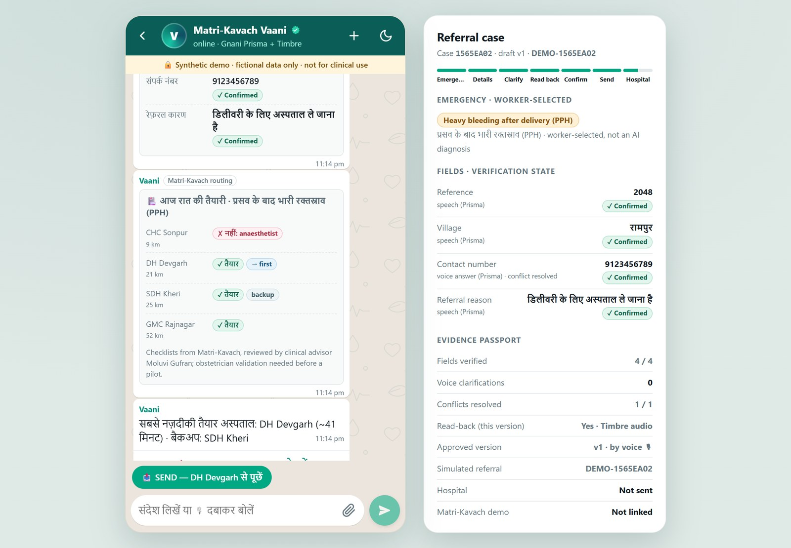</td>
</tr>
<tr>
<td valign="top">

### 6 · The hospital's phone: 2 minutes to reply
DH Devgarh sees the emergency, what is needed, the reference, the village, the reason and the ETA, with **a 2-minute timer and ✓ / ✗**. It **never** sees the patient's phone number.

</td>
<td>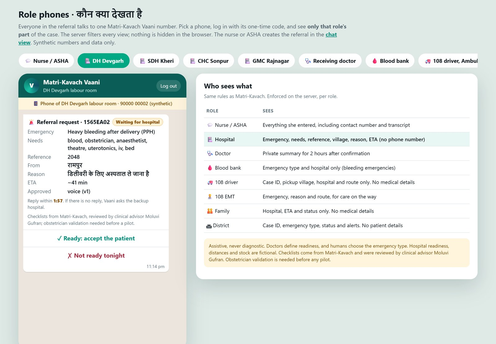</td>
</tr>
<tr>
<td valign="top">

### 7 · Not ready? Automatic backup
DH taps **✗ Not ready** (or simply doesn't answer within 2 minutes), so Vaani **re-routes to SDH Kheri** on its own. SDH accepts: **108 Ambulance 1** is assigned, and the driver, EMT, doctor, blood bank and family are told. The worker watches it happen live in her chat.

</td>
<td>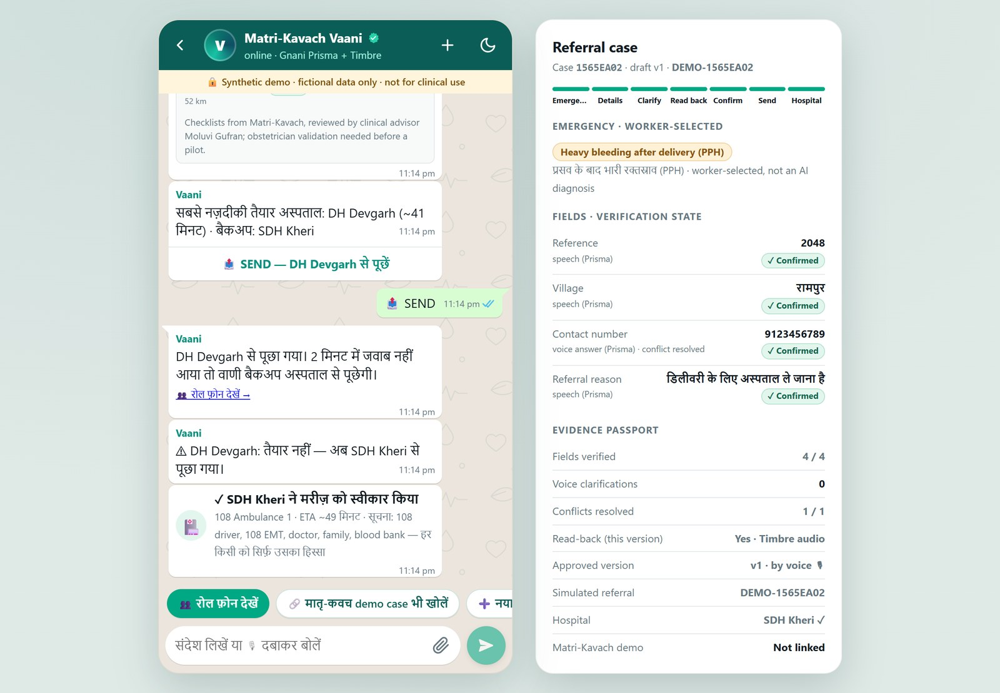</td>
</tr>
<tr>
<td valign="top">

### 8 · The reviewer dashboard
The same case appears in the audit view at `/`: fields can be edited, the voice assistant shows its conflict choices, and every field has a verification state, alongside the Evidence Passport and timeline.

</td>
<td>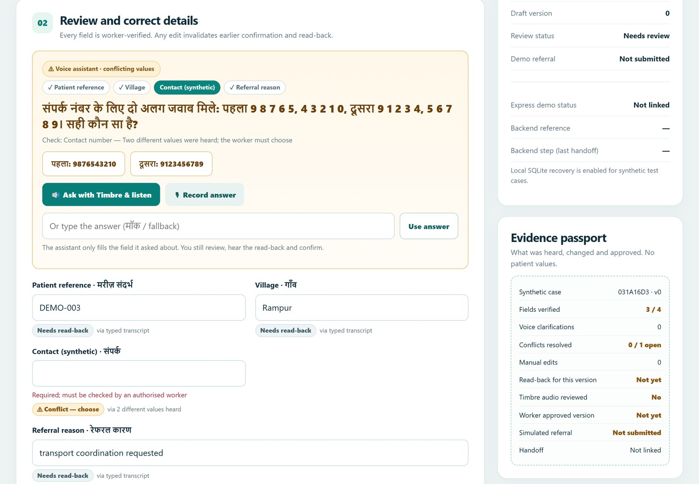</td>
</tr>
</table>

---

## 🔐 Who sees what (role phones)

Like Matri-Kavach's *"Switch phone"*, every role logs in on **its own phone** at `/roles`, with a synthetic number and a one-time code. **Every view is an allow-list built on the server**, so nothing is hidden in the browser.

<table>
<tr>
<td width="33%">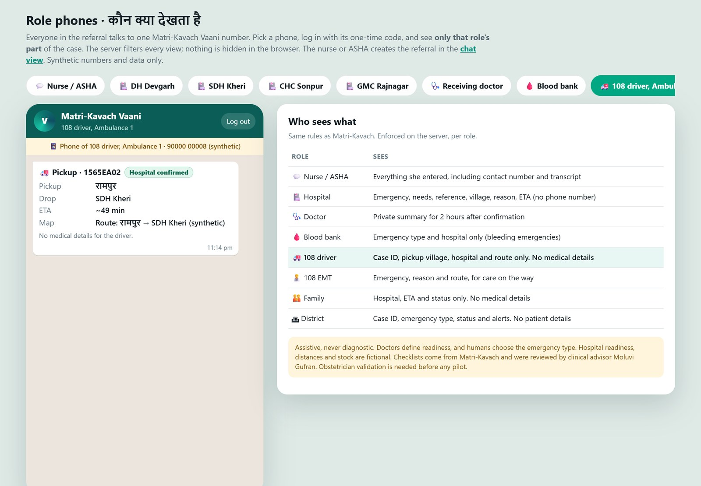<br><b>🚑 108 driver</b>: pickup, hospital and route. <b>No medical details.</b></td>
<td width="33%">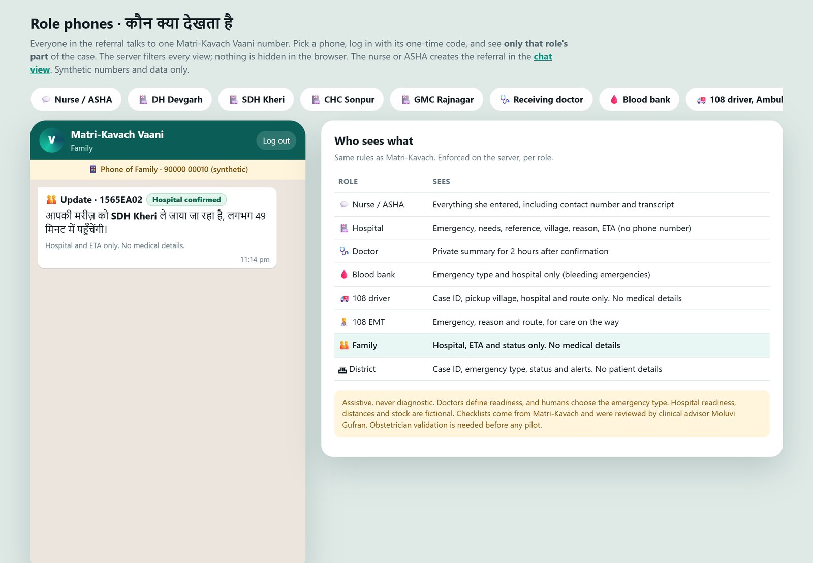<br><b>👪 Family</b>: hospital and ETA, in Hindi. <b>No medical details.</b></td>
<td width="33%">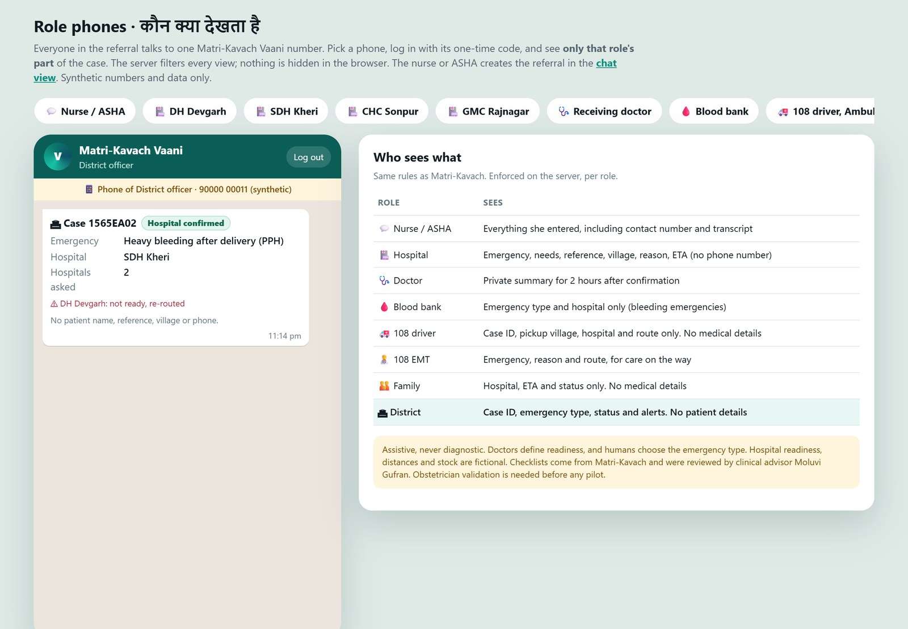<br><b>🏛 District</b>: case ID, status and alerts. <b>No name, reference, village or phone.</b></td>
</tr>
</table>

| Role | Sees | Never sees |
|---|---|---|
| 🧑‍⚕️ **Nurse / ASHA** (`/chat`) | Everything she entered | — |
| 🏥 **Asked hospital** | Emergency, needs, reference, village, reason, ETA, 2-minute timer, ✓ / ✗, arrival | Phone number, transcript |
| 🩺 **Receiving doctor** | A private summary that **expires 2 hours** after confirmation | Phone number |
| 🩸 **Blood bank** | Emergency type and hospital (bleeding emergencies only) | Patient details |
| 🚑 **108 driver** | Case ID, pickup village, hospital, route | Any medical detail |
| 🧑‍⚕️ **108 EMT** | Emergency, reason and route, for care on the way | Phone number |
| 👪 **Family** | Hospital and ETA | Any medical detail |
| 🏛 **District** | Case ID, emergency type, status, re-route alerts | Name, reference, village, phone |

---

## ⚙️ How it works

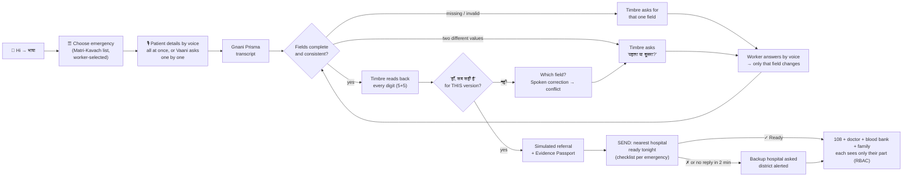

<details>
<summary><b>The Matri-Kavach concept, step by step</b></summary>

| Matri-Kavach step | In Vaani |
|---|---|
| Hi → language → **choose emergency** (the same list, with checklists reviewed by clinical advisor Moluvi Gufran) | The same, in chat. The worker chooses the emergency; Vaani never diagnoses. |
| **Fill patient details** | Spoken all at once, or with Vaani asking one by one. Conflicts are resolved, every digit is read back, and approval is spoken. |
| **SEND to the proposed hospital** | Readiness is checked against each emergency's checklist (for PPH: blood, anaesthetist, theatre…). The nearest ready hospital is asked first; the next ready one is the backup. |
| **Hospital confirms, no reply, or re-route** | The hospital replies ✓ or ✗ on its role phone. With no reply in **2 minutes**, the backup is asked automatically. If no hospital is left, the district is alerted. |
| **Doctor, blood bank, family and 108 are told** | On confirmation, the ambulance is assigned and each role gets only its part. |
| **Arrival** | The hospital taps 🏁 *Patient arrived*. |

</details>

---

## ✨ What makes it different

| | Capability | What happens |
|---|---|---|
| 🗣 | **Understands natural speech** | *"रामपुर की मरीज़ है, नंबर 98765 43210, डिलीवरी के लिए अस्पताल ले जाना है"* fills every field without keywords. On our fixtures, questions per draft drop from **3.43 to 1.57**, with **0 wrong values**. |
| ❓ | **Asks instead of guessing** | For a missing detail, Timbre asks (*"मरीज़ के गाँव का नाम बताइए।"*), and the answer fills **only that field**. Two modes: say everything at once, or let Vaani ask one by one. |
| ⚠️ | **Contradiction-aware** | With two different numbers it picks neither and asks *"पहला या दूसरा?"*. It understands "पहला/दूसरा", Prisma's ITN "1st/2nd", the value itself, or a tap. |
| 🔁 | **No silent overwrites** | A spoken correction (*"रामपुर नहीं, सोनपुर"*) becomes a conflict for the worker to choose, and any earlier approval is cancelled. The history keeps both values. |
| 🔢 | **ICAO-style read-back** | Phone numbers are read one digit at a time, grouped 5+5. |
| ✅ | **Hands-free, strict approval** | Only *"हाँ, सब सही है"* approves, and only after the Timbre read-back **audio** of that exact version. A bare *"हाँ"* is not enough, and any *"नहीं/गलत"* never approves. |
| 🙅 | **Rejects non-answers** | *"हाँ"*, *"ok"*, *"kya?"*, *"पता नहीं"* and silence never become a value. Negation in a clinical reason (*"साँस नहीं आ रही"*) is kept as said. |
| 🧩 | **Built for real Prisma output** | Devanagari numerals (९८७६…), spoken digit words, *"double five"*, English markers written in Devanagari (*"विलेज"*, *"रीज़न"*), *"रेफ़रेंस"* with or without the nukta. |
| 🏥 | **Readiness-based routing** | Nearest ready hospital first, automatic backup, a 2-minute reply timer, and district alerts. |
| 🔐 | **Server-side RBAC** | 11 role phones with one-time-code login and signed tokens. Each role gets an allow-listed view, and the phone number never leaves the worker's own view. |
| 🧾 | **Evidence Passport** | What was heard, changed and approved, and by whom (voice or tap). It contains no patient values. |

## 🎙️ Gnani models used

| Model | Used for | How |
|---|---|---|
| **Prisma v2.5** (default: `hi-IN`, `format=transcribe`, native-numeral ITN) | The referral, every clarification answer, spoken corrections and the spoken approval | REST `POST /stt/v3`. The browser records **16 kHz mono WAV**, because the REST API does not accept webm. |
| **Prisma v3.0** (`GNANI_STT_PROFILE=codemix`) | Optional Hinglish profile | `language_code=hi-IN,en-IN`, `format=codemix`. Vaani's own question is sent as `previous_text`, so one-word replies are transcribed in context. |
| **Timbre v2.5** (Nalini) or **v3.0** (Shivani) | Every question, the approval prompt and the digit-by-digit read-back | REST `POST /api/v1/tts/inference`, Hindi WAV, auto-played as voice notes. |

## 📊 Evidence

| What we tested | Result | Reproduce |
|---|---|---|
| Automated tests (offline, with Gnani stubbed) | **221 / 221 pass** | `py -m unittest discover -s tests` |
| **False-ready safety eval:** 24 transcripts pushed straight to submit, 15 bypass attempts (5 of them voice-approval tricks), 26 non-answers | **0 false-ready · 0 bypasses · 0 non-answers accepted.** The eval catches deliberately broken guards. | `py benchmarks\run_safety_eval.py` → [report](benchmarks/results/safety_eval_report.md) |
| **RBAC leak sweep:** a routed case (with a re-route) read from all 11 role phones | **0 leaks.** No phone number or transcript anywhere, and no medical details for the driver, family, district or blood bank. A deliberately injected leak is caught. | `py benchmarks\run_safety_eval.py` |
| **Natural-speech extraction** (14 fictional transcripts) | Markers only: 30/56 fields, 3.43 questions per draft. **Natural: 56/56 fields, 0 wrong values, 1.57 questions per draft.** | `py benchmarks\run_natural_eval.py` → [report](benchmarks/results/natural_eval_report.md) |
| **Routing rules** | PPH skips CHC (no anaesthetist) and goes to DH Devgarh; eclampsia goes to SDH Kheri (DH has no HDU), matching Matri-Kavach | `py -m unittest tests.test_routing_rbac` |
| **Live Gnani run** (developer key, fictional case) | Prisma transcribed a Hindi referral with Devanagari numerals; Timbre asked a conflict question, the spoken answer resolved it, and the read-back played. This run surfaced two real bugs (ITN *"१st"* and a stale passport), both fixed. | `py scripts\live_smoke_test.py` (15 checks) |
| Noise robustness (clean / 10 dB / 5 dB / 8 kHz phone) | Run with your key. The report separates wrong values (dangerous) from abstentions (safe, because Vaani asks). | `py benchmarks\run_tts_benchmark.py C:\private\tts_bench` |

These results check the workflow guardrails on synthetic input. They do not measure field speech-recognition accuracy, and none of this is clinical validation.

---

## 🚀 Run it

```cmd
py -m pip install -r requirements.txt
py -m uvicorn app.main:app --host 127.0.0.1 --port 8000
```

| Open | What you see |
|---|---|
| **http://localhost:8000/chat** | 💬 The worker's chat (start here) |
| **http://localhost:8000/roles** | 📱 Role phones: hospitals, doctor, blood bank, 108, family, district |
| **http://localhost:8000** | 🗂 Reviewer dashboard |

**Try the whole loop:** in the chat, tap **Hi → हिंदी → ☰ आपातकाल चुनें**, then **"Sample: दो अलग नंबर" → "दूसरा" → "✓ हाँ, सब सही है" → 📤 भेजें → 📤 SEND**. Open `/roles` in a second tab, log in as **DH Devgarh** and tap **✗ Not ready**, then log in as **SDH Kheri** and tap **✓ Ready**. The chat updates live.

<details>
<summary><b>🎙 Live mode with your Gnani key</b> (real Prisma + Timbre)</summary>

```cmd
set GNANI_MODE=live
set GNANI_API_KEY=your_real_key
py scripts\check_gnani.py
py scripts\live_smoke_test.py
py -m uvicorn app.main:app --host 127.0.0.1 --port 8000
```

- `check_gnani.py` diagnoses the key and its access without printing it.
- `live_smoke_test.py` runs the full voice loop with Timbre playing the worker.
- In PowerShell, use `$env:GNANI_MODE="live"` and `$env:GNANI_API_KEY="..."`.
- Optional settings: `GNANI_STT_PROFILE=codemix`, and `GNANI_TIMBRE_MODEL=timbre-v3.0` with `GNANI_TIMBRE_VOICE=Shivani`.
- Mic recording needs `localhost` or HTTPS.

</details>

<details>
<summary><b>🌐 Deploy a public preview</b> (Render, free tier)</summary>

`render.yaml` is included. The public preview runs in **mock mode** (no Gnani key, no credits used, fictional data only). With `DEMO_OPEN=1` anyone can open it, no password. Without it, the preview asks for a shared password and refuses to start without one.

| Environment variable | Value |
|---|---|
| `PYTHON_VERSION` | `3.11.11` |
| `GNANI_MODE` | `mock` |
| `DEMO_PUBLIC` | `1` |
| `CASE_DB_PATH` | `/tmp/matri-vaani-demo.sqlite3` |
| `DEMO_OPEN` | `1` (open to everyone; remove it to require `DEMO_ACCESS_PASSWORD`, 16+ characters, secret) |

- **Build:** `pip install -r requirements.txt`
- **Start:** `uvicorn app.main:app --host 0.0.0.0 --port $PORT`
- **Health check path:** `/api/health`
- Each role phone still logs in separately with its one-time code. (Password mode only: visitors first log in with the username `demo`.)

See [docs/STAGE10_DEPLOYMENT.md](docs/STAGE10_DEPLOYMENT.md).

</details>

---

## 🛡 Safety by design

**Why turning a transcript into fields is rule-based.** The AI here is Gnani's speech models. Field extraction is deterministic on purpose:

- **No invented values.** A rule finds a value or leaves the field empty. An empty field is the safe failure, because Vaani then asks. A generative model could produce a plausible but wrong phone number, and nothing would ask about it.
- **Every value can be explained.** Each field records its source (speech, voice answer or manual edit), which the Evidence Passport shows.
- **It is testable.** The same transcript always gives the same fields, so the safety eval can show that nothing wrong gets through.

**Workflow guarantees:**

- An answer changes only the field that was asked about. Clarification never approves anything.
- Every change creates a new version and cancels earlier read-backs and approvals.
- Submission needs the read-back and an explicit approval of the exact current version. It is idempotent.
- Routing starts only after submission. Hospitals see a case only while they are asked or have confirmed it; other roles see it only after confirmation.
- Keys stay on the server and are never returned or logged. The public preview is mock-only.
- The optional handoff to the original Matri-Kavach engine sends **no patient fields**.

A language model could later *suggest* values for very free-form speech, but those suggestions would still go through the same ask, read-back and approve loop.

## 🗺️ Scope and roadmap

The prototype covers the four details where one wrong value delays care the most: **patient reference, village, contact number and reason**. It runs the full Matri-Kavach referral around them.

1. **WhatsApp channel:** ASHAs already send voice notes there. The same agent would take voice notes in and reply with Timbre voice notes.
2. **More referral fields** in the same loop: danger sign (from a fixed list), weeks of pregnancy and blood group.
3. **More languages:** Prisma and Timbre support many Indian languages. Bhojpuri-speaking regions, Odia, Bengali and Marathi are next.
4. **Real-voice evaluation:** fictional referrals recorded by several speakers, to measure field accuracy on real audio.
5. **Field feedback** from ASHA workers and nursing students before any pilot.

## ⚠️ Limits

- Extraction is rule-based (marker patterns first, then natural-speech patterns). Very free-form speech can leave fields blank, which is the safe failure, because Vaani asks. The natural-speech numbers are from in-sample fixtures.
- Hospital readiness, distances, stock and ambulance assignment are fictional, as in Matri-Kavach. Role login is a demo: the one-time code is shown on screen.
- The noise benchmark uses Timbre-generated speech with noise added artificially. It is a robustness check, not a field study.
- The `codemix` profile and spoken approval pass the offline and smoke tests but have not been checked end to end with a live key.
- The screenshots use fictional data, and Gnani responses were simulated so that each step could be captured.

---

## 📁 Repository map

```
app/main.py            FastAPI endpoints: versioned case workflow, field states, Evidence Passport
app/clarify.py         Clarification questions, answer parsing, conflict resolution, spoken approval
app/extraction.py      Marker + natural-speech extraction and conflict detection (Prisma-style Hindi/Hinglish)
app/routing.py         Readiness checklists, nearest-ready routing, backup, 2-minute timer, arrival
app/rbac.py            Role logins (one-time code, signed token) and allow-listed views per role
app/prisma.py          Gnani Prisma REST adapter (hindi / codemix profiles, previous_text context)
app/timbre.py          Gnani Timbre REST adapter (bounded, validated WAV)
app/core.py            Case model: versions, read-back / approval digests, conflicts, resolution history
app/static/chat.html   💬 Chat view: Matri-Kavach opening, voice notes, Timbre replies, hands-free loop
app/static/roles.html  📱 Role phones: hospital, doctor, blood bank, 108, family, district
app/static/index.html  🗂 Reviewer dashboard
app/static/voice.js    Shared recorder: MediaRecorder → 16 kHz mono WAV + live level
benchmarks/            Safety eval (+ RBAC leak sweep), natural-speech eval, fixtures, TTS noise benchmark
scripts/               check_gnani.py (key diagnosis), live_smoke_test.py (live end-to-end check)
docs/                  Architecture, API, evidence, submission kit, video script, screenshots
tests/                 221 offline tests
```

📚 [Architecture](docs/ARCHITECTURE.md) · [API](docs/API_CONTRACT.md) · [Innovation & evidence](docs/INNOVATION_AND_EVIDENCE.md) · [Submission kit](docs/SUBMISSION_KIT.md) · [Video script](docs/VIDEO_SCRIPT.md) · [Deployment](docs/STAGE10_DEPLOYMENT.md)

## 👥 Team

| | Name | Role |
|---|---|---|
| 🧑‍💻 | **Manas Girdhar** | Team member |
| 🧑‍💻 | **Meenakshi Satpathy** | Team member |

🩺 **Clinical advisor:** **Moluvi Gufran** reviewed the Matri-Kavach emergency checklists. Not a member of the competing team.

## 🙏 Acknowledgements

- **Gnani AI** for Prisma, Timbre and the Great Indian AI Internship Challenge.
- The **Matri-Kavach** MVP, whose referral concept, emergency checklists, readiness rules and "who sees what" model Vaani builds on.
- ASHA workers everywhere, who carry this work every night.

## 📄 License

MIT. See [LICENSE](LICENSE).

<div align="center"><sub>Made with care for the mothers of rural India 🇮🇳 · Synthetic data only · Not a clinical tool</sub></div>
